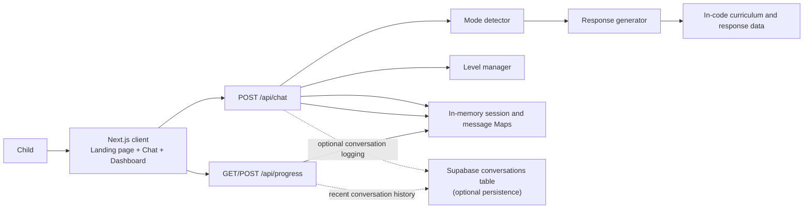
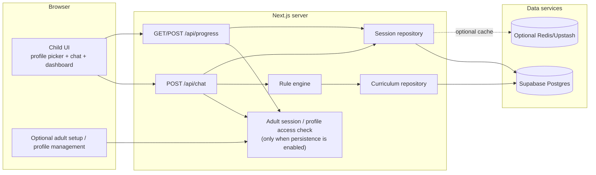

# Buddy English Learning App — Architecture

## 1. Product goals

Buddy is a child-friendly English learning app for children roughly ages 2–7.
Children can start learning without registering or remembering a password. The
app provides a guided chat, structured lessons, quiz feedback, mood check-ins,
XP, level progression, and a progress dashboard.

The learning engine is deterministic and rule-based; it does not call an LLM.
This keeps replies predictable and avoids an external AI dependency.

## 2. Implemented architecture



### Request flow

1. The landing page collects a name and age and creates child/session IDs in
   browser storage. There is no account or authentication flow.
2. The chat page submits messages, quiz answers, and mood selections to
   `POST /api/chat`.
3. The API loads the session from the in-memory store, records the message,
   detects a mode, and calls the response generator.
4. The response generator uses the in-code lessons, conversation rules, and
   response templates. The API updates XP, streaks, lesson position, and level.
5. The API returns a reply and updated session details to the client.
6. If Supabase is configured, the API attempts to store the child profile,
   conversation, and progress. Dashboard progress is primarily read from the
   in-memory session store; recent conversation history is queried from
   Supabase.

## 3. Source layout

```text
app/
├── page.jsx                       # Name/age entry and session creation
├── chat/page.jsx                  # Chat, mood picker, quiz UI, dashboard
├── api/
│   ├── chat/route.js              # Chat request orchestration and persistence
│   └── progress/route.js          # Dashboard reads and progress reset/mood
└── lib/
    ├── constants.js               # Curriculum, rules, templates, XP settings
    ├── session-store.js            # In-memory sessions and recent messages
    ├── supabase.js                 # Optional Supabase client
    └── engine/
        ├── mode-detector.js        # Keyword/rule-based interaction mode
        ├── response-generator.js   # Replies, lesson choice, answer checking
        └── level-manager.js        # Level completion checks

supabase/migrations/
└── 20261017000000_create_conversations.sql
```

The app uses JavaScript/JSX. Next.js API handlers are server-side; browser code
must never receive a Supabase service-role key.

## 4. Current behavior and limitations

### Learning content and progression

- Curriculum content, conversation rules, response templates, mood labels, XP
  rewards, and level rules are defined in `app/lib/constants.js`.
- The response engine selects content and evaluates answers in
  `app/lib/engine/response-generator.js`.
- Mode detection is keyword-based. It is separate from the selected mood; a
  mood is saved in the session, but it does not yet consistently choose a
  mood-specific response.
- XP, streaks, lesson index, active quiz, and current level are held in server
  process memory by `app/lib/session-store.js`.
- In-memory progress is lost when the server restarts and is not shared between
  multiple server instances.
- The dashboard does not currently load persisted progress records.

### Database persistence

The only checked-in migration creates `public.conversations`. There are no
migrations for the `children` or `progress` tables, although the chat API also
attempts to upsert `children` and insert `progress`. The `children` upsert and
`progress` insert results are not checked, so database errors from those writes
can go unnoticed. The conversation insert has explicit error logging. A
configured Supabase project therefore needs schema/API alignment before child
profiles or learning progress can be considered persisted reliably.

The conversations table has row-level security enabled and no public policies.
The server currently uses a service-role key when available, with publishable
or anon keys as fallbacks. A service-role key bypasses RLS and must stay
server-only; anon/publishable keys do not provide the same write permissions.
Do not treat client-supplied child or session IDs as authorization.

### Authentication and child access

There is no login system. This is appropriate for the child-facing experience,
but the current generated IDs and in-memory store are for a prototype, not
secure multi-family account isolation or cross-device progress.

## 5. Recommended target architecture

Keep the child experience account-free. Add adult-managed access only if the app
needs persistent profiles, multiple children, or access from multiple devices.



### Design choices

- **No child passwords.** Keep onboarding to a nickname and an age band. If
  profiles must sync across devices, use an adult-controlled account or a
  parent/teacher-issued access code, not a password the child must remember.
- **One source of truth for progress.** Persist session/progression state and
  answer attempts in Postgres. Add Redis only when deployment scale or measured
  latency requires it; it is unnecessary for the current small rule engine.
- **Keep the deterministic engine.** Keep mode detection, answer evaluation,
  response generation, and level progression as server-side modules with
  explicit inputs and outputs.
- **Keep curriculum in code initially.** Move lessons to a database only when
  non-developers need to edit curriculum or lessons need remote publishing.
- **Separate persistence concerns.** Store conversation logs independently from
  child profiles and progress so a failure in one write does not silently skip
  the others.
- **Protect child data.** Use server-side authorization and database policies
  before enabling persistent profiles. Minimize personal data; do not store
  full birthdates, photos, or sensitive free-form information unless required.

## 6. Recommended data model when persistence is implemented

The following is a target schema, not a description of the current database.
Every child-owned row must be scoped to a parent/teacher account or another
server-verifiable access boundary.

### `children`

- `id`: UUID primary key
- `owner_id`: adult account or organization identifier
- `nickname`: required display name
- `age_band`: optional coarse age range; avoid collecting birth date
- `current_level`, `xp`: current progression summary
- `created_at`, `updated_at`

### `learning_sessions`

- `id`: UUID primary key
- `child_id`: foreign key to `children`
- `current_level`, `lesson_index`, `current_topic`, `current_subtopic`
- `mood`, `consecutive_correct`, `consecutive_wrong`, `message_count`
- `active_quiz`: JSONB or normalized quiz reference
- `last_activity`, `created_at`, `updated_at`

### `answer_attempts`

- `id`: UUID primary key
- `child_id`, `session_id`
- `lesson_id` or stable curriculum lesson key
- `answer`, `is_correct`, `xp_gained`, `created_at`

### `conversations`

Keep the existing role/message/mode/mood/metadata fields and associate each row
with the authorized child and session. Apply owner-scoped RLS policies before
allowing browser-accessible database operations. The server API should remain
the authority for writing generated bot replies.

### `lessons` (optional future migration)

Only introduce this table if curriculum needs remote editing or publishing.
Until then, use the stable lesson IDs and content definitions in
`app/lib/constants.js` as the source of truth.

## 7. API contracts

### `POST /api/chat`

Accepts a child/session identifier, a message or selected quiz answer, and an
optional validated mood. The server validates input, loads state, detects mode,
generates the reply, updates progress, and returns:

```json
{
  "reply": "Let's learn...",
  "mode": "learning",
  "xpGained": 0,
  "levelUp": false,
  "isQuiz": true,
  "options": ["A"],
  "session": {
    "level": 1,
    "xp": 0,
    "topic": "alphabet",
    "consecutiveCorrect": 0,
    "consecutiveWrong": 0,
    "mood": "happy",
    "lessonIndex": 0
  }
}
```

For persistent profiles, never authorize a request solely from IDs supplied by
the browser. Resolve the profile through the authenticated adult or
server-validated access code.

### `/api/progress`

- `GET`: returns current level, XP, curriculum progress, mood, streak, and
  recent conversation history.
- `POST`: currently supports resetting progress or updating mood.

The target implementation should read and write progress through the same
persistent session repository used by chat.

## 8. Implementation plan

1. **Align persistence:** either add and test migrations for every table the
   chat API writes, or change the API to write only to the existing
   `conversations` table. Make each persistence failure explicit and isolated.
2. **Clarify session lifetime:** keep in-memory sessions for local/demo use;
   introduce a persistent session repository when progress must survive
   restarts or multiple instances.
3. **Add adult-managed access if needed:** implement adult identity/profile
   ownership before exposing saved child profiles across devices.
4. **Unify mood behavior:** map the selected mood to a deliberate response
   strategy and test each mood independently of keyword-based mode detection.
5. **Consider content administration later:** migrate curriculum to Postgres
   only when runtime editing or publishing is a real requirement.

## 9. Non-goals for the current version

- No LLM or external text-generation service.
- No child-facing login or registration.
- No Redis until scaling needs are demonstrated.
- No database-backed lesson authoring until curriculum management requires it.

## 10. Deployment Instructions

### Local Setup

1. Install project dependencies:
   ```bash
   npm install
   ```

2. Configure environment variables in `.env.local` if Supabase persistence is required:
   ```env
   NEXT_PUBLIC_SUPABASE_URL=your_supabase_project_url
   NEXT_PUBLIC_SUPABASE_ANON_KEY=your_supabase_anon_key
   SUPABASE_SERVICE_ROLE_KEY=your_service_role_key
   ```
   Use the variable names expected by the Supabase client implementation. Never expose the service-role key to client-side code or commit it to version control.

3. Start the development server:
   ```bash
   npm run dev
   ```

4. Open `http://localhost:3000` in a browser to use the application.

### Production Build

1. Build the application:
   ```bash
   npm run build
   ```

2. Start the production server locally:
   ```bash
   npm run start
   ```

### Deployment to Vercel

1. Push the project to a GitHub repository.
2. Import the repository into Vercel.
3. Configure the required environment variables in the Vercel project settings.
4. Apply the SQL migration in `supabase/migrations/` if Supabase is configured.
5. Deploy the application and open the generated URL.
6. Verify the landing page, chat interactions, quizzes, mood selection, and progress dashboard.

### Deployment Considerations

- The application can run without Supabase using in-memory session storage.
- In-memory session and progress data may be lost when the server restarts and may not be shared across server instances.
- The existing database migration creates only the `conversations` table. Additional schema changes are required for reliable child profile and progress persistence.
- Before production use, validate database permissions, input handling, and server-side access controls to protect children's data.
