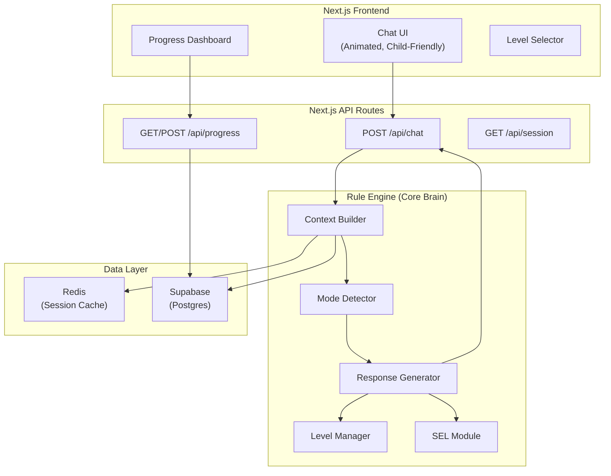

# 🧒 AI-Powered English Learning Chatbot — Architecture Plan

> **Stack:** Next.js (App Router) + Supabase (Postgres + Auth) + Redis  
> **AI Approach:** Non-LLM — Rule-based / Template Engine  
> **Target:** Children under 7 years old

---

## 1. System Architecture



---

## 2. Database Schema (Supabase / Postgres)

### 2.1 `children` — User Profiles

```sql
CREATE TABLE children (
  id UUID PRIMARY KEY DEFAULT gen_random_uuid(),
  name TEXT NOT NULL,
  age INTEGER CHECK (age >= 2 AND age <= 7),
  avatar TEXT DEFAULT 'default',
  current_level INTEGER DEFAULT 1 CHECK (current_level BETWEEN 1 AND 3),
  xp INTEGER DEFAULT 0,
  created_at TIMESTAMPTZ DEFAULT NOW(),
  updated_at TIMESTAMPTZ DEFAULT NOW()
);
```

### 2.2 `progress` — Learning Progress per Topic

```sql
CREATE TABLE progress (
  id UUID PRIMARY KEY DEFAULT gen_random_uuid(),
  child_id UUID REFERENCES children(id) ON DELETE CASCADE,
  level INTEGER NOT NULL CHECK (level BETWEEN 1 AND 3),
  topic TEXT NOT NULL,           -- e.g., 'alphabet', 'colors', 'animals'
  subtopic TEXT,                 -- e.g., 'letter_A', 'red', 'dog'
  score INTEGER DEFAULT 0,      -- 0-100
  attempts INTEGER DEFAULT 0,
  completed BOOLEAN DEFAULT FALSE,
  completed_at TIMESTAMPTZ,
  created_at TIMESTAMPTZ DEFAULT NOW()
);
```

### 2.3 `conversations` — Chat Logs

```sql
CREATE TABLE conversations (
  id UUID PRIMARY KEY DEFAULT gen_random_uuid(),
  child_id UUID REFERENCES children(id) ON DELETE CASCADE,
  session_id TEXT NOT NULL,
  role TEXT NOT NULL CHECK (role IN ('child', 'bot')),
  message TEXT NOT NULL,
  detected_mode TEXT,            -- 'learning', 'conversation', 'bored', 'upset', 'excited'
  metadata JSONB DEFAULT '{}',
  created_at TIMESTAMPTZ DEFAULT NOW()
);
```

### 2.4 `sel_content` — Social-Emotional Learning Content

```sql
CREATE TABLE sel_content (
  id UUID PRIMARY KEY DEFAULT gen_random_uuid(),
  level INTEGER NOT NULL CHECK (level BETWEEN 1 AND 3),
  type TEXT NOT NULL CHECK (type IN ('encouragement', 'check_in', 'celebration', 'comfort', 'curiosity')),
  content TEXT NOT NULL,
  trigger_mode TEXT              -- optional: only show when child is in this mode
);
```

### 2.5 `lessons` — Structured Lesson Content

```sql
CREATE TABLE lessons (
  id UUID PRIMARY KEY DEFAULT gen_random_uuid(),
  level INTEGER NOT NULL CHECK (level BETWEEN 1 AND 3),
  topic TEXT NOT NULL,
  subtopic TEXT NOT NULL,
  lesson_type TEXT NOT NULL CHECK (lesson_type IN ('teach', 'quiz', 'practice', 'game')),
  content JSONB NOT NULL,        -- structured lesson data (see Section 4)
  display_order INTEGER DEFAULT 0,
  created_at TIMESTAMPTZ DEFAULT NOW()
);
```

---

## 3. Redis Data Structures

Redis is used for **fast session state** to achieve sub-2s latency.

### 3.1 Session Context (per child, per session)

```
Key:    session:{child_id}:{session_id}
Type:   Hash
TTL:    1 hour (auto-expire)

Fields:
  current_level       → "1"
  current_topic       → "colors"
  current_subtopic    → "red"
  detected_mode       → "learning"
  message_count       → "12"
  last_activity       → "2026-10-17T08:00:00Z"
  sel_last_shown      → "encouragement"
  consecutive_correct → "3"
  consecutive_wrong   → "0"
```

### 3.2 Recent Messages (sliding window)

```
Key:    messages:{child_id}:{session_id}
Type:   List (capped at 10 items)
TTL:    1 hour

Each item: JSON string → { "role": "child", "text": "i like red", "timestamp": "..." }
```

### 3.3 Cached Level Data

```
Key:    level_cache:{level}
Type:   String (JSON)
TTL:    24 hours

Value:  Serialized lesson structure for fast retrieval
```

---

## 4. Progressive Learning System (L1 → L2 → L3)

### 4.1 Level Curriculum

| Level | Age Range | Topics | Lesson Style |
|-------|-----------|--------|-------------|
| **L1** | 2-4 yrs | Alphabet (A-Z), Numbers (1-10), Colors, Shapes | Single words, images, sounds, tap-to-answer |
| **L2** | 4-5 yrs | Animals, Fruits, Body Parts, Simple Verbs, Greetings | Two-word phrases, matching, fill-in-the-blank |
| **L3** | 5-7 yrs | Sentences, Opposites, Prepositions, Short Stories, Feelings | Full sentences, reading, simple conversations |

### 4.2 Level Progression Rules

```javascript
// Level-up criteria
const LEVEL_UP_RULES = {
  1: { requiredTopics: 4, minAvgScore: 70, minXP: 500 },
  2: { requiredTopics: 5, minAvgScore: 75, minXP: 1200 },
  3: { /* max level — no progression */ }
};

// XP rewards
const XP_REWARDS = {
  correct_answer: 10,
  complete_lesson: 50,
  complete_topic: 200,
  streak_bonus_3: 30,   // 3 correct in a row
  streak_bonus_5: 80,   // 5 correct in a row
  daily_login: 20
};
```

### 4.3 Lesson Content Format (JSONB)

```json
// Example: L1 → Colors → "Red" (teach type)
{
  "type": "teach",
  "word": "Red",
  "phonetic": "rɛd",
  "emoji": "🔴",
  "image_url": "/images/colors/red.png",
  "example_sentence": "The apple is red.",
  "fun_fact": "Fire trucks are red! 🚒",
  "practice_prompts": [
    { "type": "identify", "question": "What color is this? 🔴", "answer": "red" },
    { "type": "pick", "question": "Which one is red?", "options": ["🔴", "🔵", "🟢"], "answer": "🔴" },
    { "type": "complete", "question": "The strawberry is ___", "answer": "red" }
  ]
}
```

---

## 5. Rule Engine — Core Brain

### 5.1 Mode Detection (Non-LLM)

The mode detector classifies the child's state using **keyword matching, message patterns, and session metrics**.

```javascript
// Mode detection rules
function detectMode(recentMessages, sessionState) {
  const lastMsg = recentMessages[0]?.text?.toLowerCase() || '';
  const msgCount = sessionState.message_count;
  const consecutiveWrong = sessionState.consecutive_wrong;

  // 1. UPSET / FRUSTRATED
  if (containsAny(lastMsg, ['i cant', "i can't", 'too hard', 'i dont know', 'help me', 'sad', 'no', 'stop'])) {
    return 'upset';
  }
  if (consecutiveWrong >= 3) {
    return 'upset';
  }

  // 2. BORED / DISENGAGED
  if (lastMsg.length <= 2 && msgCount > 5) {
    return 'bored';
  }
  if (containsAny(lastMsg, ['boring', 'bored', 'dont want', "don't want", 'no more'])) {
    return 'bored';
  }

  // 3. EXCITED / HAPPY
  if (containsAny(lastMsg, ['yay', 'yes', 'wow', 'cool', 'awesome', 'i did it', 'more', '!'])) {
    return 'excited';
  }
  if (sessionState.consecutive_correct >= 3) {
    return 'excited';
  }

  // 4. CONVERSATION (non-lesson chat)
  if (containsAny(lastMsg, ['hi', 'hello', 'how are you', 'my name', 'what is your', 'tell me', 'i like', 'do you'])) {
    return 'conversation';
  }

  // 5. Default: LEARNING
  return 'learning';
}
```

### 5.2 Response Generator — Template System

```javascript
const RESPONSE_TEMPLATES = {
  // When child is upset/frustrated
  upset: {
    responses: [
      "It's okay! 🤗 Everyone makes mistakes. That's how we learn!",
      "Don't worry! Let's try something easier together. You're doing great! ⭐",
      "Hey, it's alright! Even superheroes need practice! 💪",
      "Let's take a little break. Want to play a fun game instead? 🎮"
    ],
    action: 'reduce_difficulty'  // Switch to easier content
  },

  // When child is bored
  bored: {
    responses: [
      "Hey! Want to play a fun game? 🎲",
      "Let's try something different! How about a story? 📖",
      "Ooh, I have a surprise! Let's play 'Guess the Animal!' 🐾",
      "Want to see something cool? Let's learn with emojis! 🌈"
    ],
    action: 'switch_to_game'
  },

  // When child is excited
  excited: {
    responses: [
      "WOW! You're amazing! 🌟 Let's keep going!",
      "You're on fire! 🔥 Ready for a bigger challenge?",
      "Incredible! You're such a fast learner! 🚀",
      "Yay! High five! ✋ Want to try the next one?"
    ],
    action: 'increase_difficulty'
  },

  // Conversation mode
  conversation: {
    // Handled by conversation sub-engine (see 5.3)
    action: 'converse'
  },

  // Learning mode
  learning: {
    action: 'next_lesson'
  }
};
```

### 5.3 Conversation Sub-Engine (Keyword-Triggered)

```javascript
const CONVERSATION_RULES = [
  { match: ['hi', 'hello', 'hey'],           reply: "Hi there! 👋 I'm so happy to see you! What would you like to do today?" },
  { match: ['my name is', "i'm"],             reply: "What a wonderful name! 😊 Nice to meet you! Shall we learn something fun?" },
  { match: ['how are you'],                   reply: "I'm great! Thanks for asking! 😄 How are YOU feeling today?" },
  { match: ['i like'],                        reply: "Oh, that's so cool! 🌟 I like that too! Want to learn words about it?" },
  { match: ['what is your name', 'who are'],  reply: "I'm Buddy, your learning friend! 🤖✨ I love helping you learn English!" },
  { match: ['thank', 'thanks'],               reply: "You're welcome! 💕 You're doing so well! I'm proud of you!" },
  { match: ['bye', 'goodbye'],                reply: "Bye bye! 👋 You did amazing today! Come back soon! 🌈" },
  { match: ['i feel', 'feeling'],             reply: "Thank you for telling me how you feel! 💛 Your feelings matter a lot!" },
  // Fallback
  { match: [],                                reply: "That's interesting! 😊 Want to continue our lesson, or chat some more?" }
];
```

### 5.4 Context Builder

```javascript
async function buildContext(childId, sessionId) {
  // 1. Get fast data from Redis
  const session = await redis.hgetall(`session:${childId}:${sessionId}`);
  const recentMsgs = await redis.lrange(`messages:${childId}:${sessionId}`, 0, 9);

  // 2. Get learning history from Supabase (only if not cached)
  let history = await redis.get(`history:${childId}`);
  if (!history) {
    history = await supabase
      .from('progress')
      .select('*')
      .eq('child_id', childId)
      .order('created_at', { ascending: false })
      .limit(20);
    await redis.set(`history:${childId}`, JSON.stringify(history), 'EX', 300); // 5 min cache
  }

  // 3. Detect mode
  const mode = detectMode(recentMsgs.map(JSON.parse), session);

  // 4. Determine next lesson/response strategy
  const strategy = determineStrategy(mode, session, history);

  return { session, recentMsgs, history, mode, strategy };
}
```

---

## 6. API Routes

### 6.1 `POST /api/chat` — Main Chat Endpoint

```
Request:  { childId, sessionId, message }
Flow:
  1. Store message in Redis (recent messages list)
  2. Build context (Redis + Supabase)
  3. Detect mode
  4. Generate response via rule engine
  5. Store bot response in Redis
  6. Async: persist conversation to Supabase
  7. Return response

Response: { reply, mode, xpGained, levelUp?, nextAction }
```

> **Latency target:** < 200ms (Redis reads: ~1ms, rule engine: ~5ms, Redis writes: ~1ms, Supabase async write: non-blocking)

### 6.2 `GET /api/progress/:childId` — Progress Dashboard

```
Response: { level, xp, topicsCompleted, totalTopics, recentScores, streaks }
```

### 6.3 `POST /api/progress/answer` — Record Answer

```
Request:  { childId, sessionId, lessonId, answer, isCorrect }
Flow:
  1. Update Redis session (consecutive_correct/wrong, xp)
  2. Check level-up criteria
  3. Async: persist to Supabase progress table
Response: { correct, xpGained, streak, levelUp? }
```

---

## 7. SEL (Social-Emotional Learning) Integration

### 7.1 SEL Triggers

| Trigger | SEL Action | Example |
|---------|-----------|---------|
| 3+ wrong answers | **Comfort** | "It's okay! Mistakes help us grow! 🌱" |
| 5+ correct streak | **Celebration** | "You're a SUPERSTAR! ⭐⭐⭐" |
| Session start | **Check-in** | "How are you feeling today? 😊😐😢" |
| New topic unlock | **Curiosity** | "Ooh! Ready to discover something amazing? 🔍" |
| Child says "I can't" | **Encouragement** | "You CAN do it! Let's try together! 💪" |
| End of session | **Affirmation** | "You were so brave today! I'm proud of you! 🌟" |

### 7.2 Mood Check-In UI

At session start, show a simple emoji picker:

```
"How are you feeling today?"

😊 Happy    😐 Okay    😢 Sad    😴 Tired    🤩 Excited
```

The selected mood adjusts:
- **Happy/Excited** → Jump into learning
- **Okay** → Gentle warm-up, then lessons
- **Sad** → Comfort first, then light activity
- **Tired** → Shorter sessions, more games, less quizzes

---

## 8. Frontend Structure (Next.js App Router)

```
app/
├── layout.tsx              — Root layout (fonts, global styles)
├── page.tsx                — Landing / login page
├── chat/
│   ├── page.tsx            — Main chat interface
│   └── components/
│       ├── ChatBubble.tsx  — Message bubbles (animated)
│       ├── QuizCard.tsx    — Interactive quiz component
│       ├── MoodPicker.tsx  — Emoji mood check-in
│       ├── XPBar.tsx       — XP progress bar
│       └── LevelBadge.tsx  — Current level display
├── dashboard/
│   └── page.tsx            — Progress dashboard
├── api/
│   ├── chat/route.ts       — Chat endpoint
│   └── progress/route.ts   — Progress endpoint
└── lib/
    ├── engine/
    │   ├── mode-detector.ts
    │   ├── response-generator.ts
    │   ├── level-manager.ts
    │   ├── sel-module.ts
    │   └── context-builder.ts
    ├── redis.ts             — Redis client
    ├── supabase.ts          — Supabase client
    └── constants.ts         — Lessons, templates, rules
```

---

## 9. Performance Budget (Sub-2s Target)

| Operation | Expected Latency | Strategy |
|-----------|-----------------|----------|
| Redis read (session + messages) | ~2ms | In-memory cache |
| Mode detection (rule engine) | ~1ms | CPU-only, no I/O |
| Response generation (template) | ~1ms | String interpolation |
| Redis write (response) | ~1ms | Fire-and-forget |
| Supabase write (conversation log) | ~50-100ms | **Async** (non-blocking) |
| **Total server-side** | **~5-10ms** | Well under 2s ✅ |
| Network round-trip | ~50-200ms | CDN/Edge deployment |
| **Total end-to-end** | **~60-210ms** | **Well under 2s** ✅ |

> [!TIP]
> A rule-based engine is **orders of magnitude faster** than LLM API calls (which add 500-2000ms). This is a huge advantage for the performance requirement.

---

## 10. Key Design Decisions

| Decision | Choice | Rationale |
|----------|--------|-----------|
| AI approach | Rule-based templates | No API costs, guaranteed sub-2s, predictable child-safe output |
| Session state | Redis | Sub-millisecond reads, perfect for fast context building |
| Persistent storage | Supabase Postgres | Structured data, easy queries, built-in auth |
| Conversation logging | Async write to Supabase | Doesn't block response — keeps latency low |
| Level progression | XP + completion based | Gamification motivates children |
| Mode detection | Keyword + pattern matching | Simple, fast, no external dependencies |
| SEL integration | Trigger-based injection | Natural, non-intrusive emotional support |

---

## 11. Deployment Recommendation

| Component | Platform | Why |
|-----------|----------|-----|
| Next.js | **Vercel** | Native Next.js support, edge functions, free tier |
| Supabase | **Supabase Cloud** | Managed Postgres, free tier (500MB) |
| Redis | **Upstash Redis** | Serverless Redis, pay-per-request, works with Vercel Edge |

---

## 12. What's NOT Included (Future Enhancements)

- Voice input/output (Web Speech API)
- Parent dashboard / analytics
- Multi-language support
- Offline mode (PWA)
- Actual image assets (using emojis as placeholders)

---

> [!IMPORTANT]
> This architecture is designed for a **non-LLM approach**. All responses are generated via templates and rules, making the system fast, predictable, and free of external API costs. The trade-off is less natural conversation, but for children under 7, structured and predictable responses are actually **more appropriate**.
